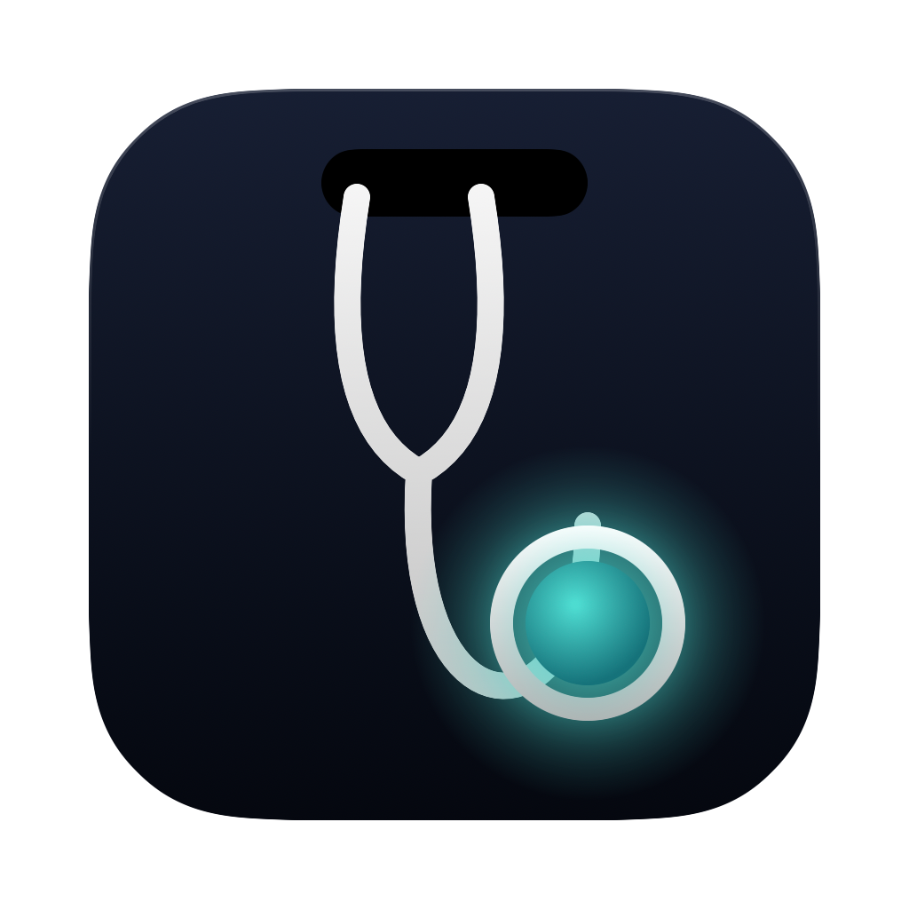
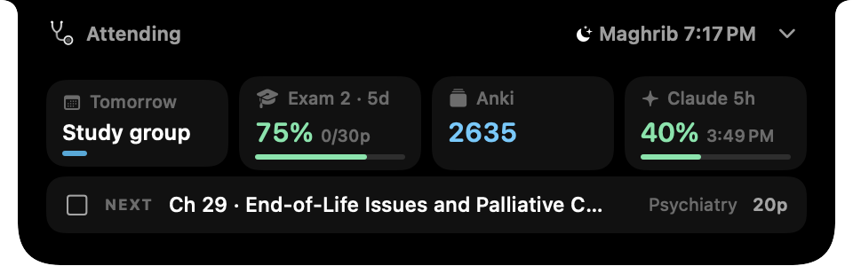
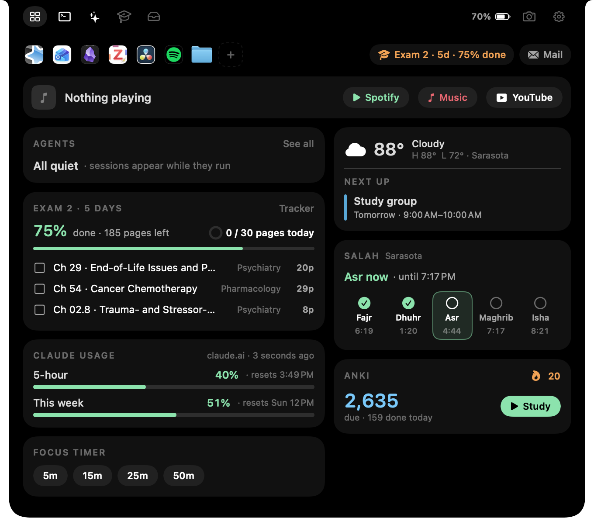
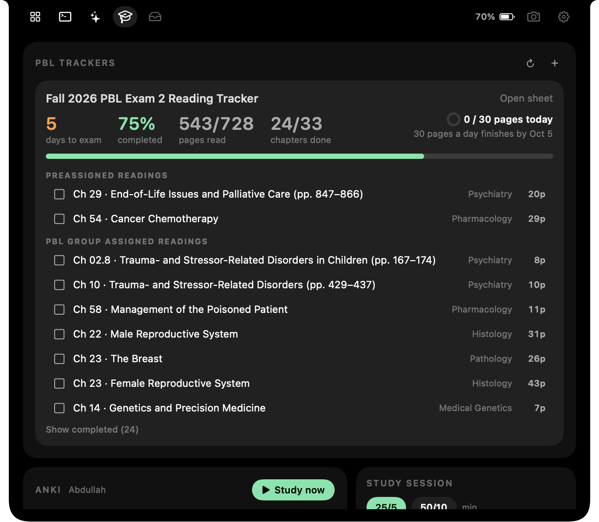
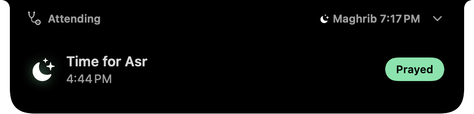

<p align="center">
  
</p>

<h1 align="center">Attending</h1>

<p align="center">
  <b>Your MacBook's notch, turned into a med school command center.</b><br>
  Exam countdowns, readings, Anki, prayer times, music, AI and your coding agents,<br>
  one hover away. Native, private and fast.
</p>

<p align="center">
  <a href="../../releases/latest"><b>Download</b></a> ·
  <a href="https://buymeacoffee.com/med.abdullah">Buy me a coffee ☕</a>
</p>

<p align="center">
  
</p>

---

## What it does

Hover the notch for a glance at your day. Click it to open everything else.



### 📚 Study
- **Reading tracker sync.** Connect a Google Sheets reading tracker (PBL, block or course readings) and check off chapters from the notch. It shows percent done, days to the exam, and **exactly how many pages to read today**, with a notch alert when you hit the goal.
- **Anki.** Cards due, reviews done today and your streak. Start a deck's review from the notch (uses AnkiConnect).
- **Focus timer and study sessions.** A Pomodoro timer that runs in the notch, with an optional Anki review goal.
- **Exam countdowns.**



### 🕌 Salah
- Prayer times for your location, calculated on your Mac (ISNA, MWL, Egyptian, Karachi or Umm al-Qura, with Standard or Hanafi Asr).
- Tap a prayer to mark it prayed, and keep a streak of days with all five.
- The notch drops down at each prayer time, and 15 minutes before one ends if you haven't prayed.



### 🎵 Music
- Now Playing for Spotify, Apple Music, YouTube and anything else playing, with a live audio visualizer in the notch.
- Spotify extras (optional): like, add to a playlist, see when a song came from Smart Shuffle, and edit your Up Next queue.

### 🤖 AI and agents
- **Ask AI:** Claude and ChatGPT inside the notch (<kbd>⌘</kbd><kbd>⇧</kbd><kbd>Space</kbd>), signed in with your own accounts.
- **Claude usage meter:** your 5-hour and weekly limits at a glance.
- **Agents:** see your Claude Code and Codex sessions, and approve or deny permission requests from the notch. While an agent works, the stethoscope turns into a live ECG.

### 🧰 Everyday
- **Drag a file to the notch** to AirDrop it, keep it on the Shelf, or upload it to Google Drive.
- **Screenshot drops:** new screenshots land on your Shelf, ready to drag anywhere.
- **Clipboard history** with pins.
- **Camera:** a quick mirror with photos, self-timer, zoom, grid, ring light and macOS video effects.
- **Status in the notch:** volume, brightness, battery and AirPods battery displays; download and video-export progress; meeting countdowns with a Join button; one-click eject for external drives.
- **Weather**, your next calendar event, and Outlook unread count.

Everything is optional and can be turned off in Settings.

## Install

**Requirements:** a Mac with a notch (it also works below the menu bar on other displays) and macOS 14.2 or later.

### Download

Grab the latest `Attending.zip` from [Releases](../../releases), unzip it, and move **Attending** to Applications.

The app isn't notarized yet, so the first time you open it, macOS may say it can't verify the developer. Open **System Settings › Privacy & Security** and click **Open Anyway**. You only need to do this once.

**Updates are automatic.** Attending checks for new releases about once a day and tells you in the notch. Click **Update**, and it downloads, verifies and installs the new version, then relaunches. You can also check in Settings › Updates.

### Build from source

You need Xcode, or just the Command Line Tools (`xcode-select --install`).

```sh
git clone https://github.com/med-abdullah/attending.git
cd attending
./scripts/create-signing-identity.sh   # optional: keeps macOS permissions across updates
./scripts/build-app.sh release
./scripts/install-app.sh               # copies to /Applications
open /Applications/Attending.app
```

To use your own bundle ID or signing identity, copy `scripts/local.env.example` to `scripts/local.env` and edit it.

## Setup (all optional)

| Feature | What to do |
|---|---|
| Calendar, weather, prayer times | Allow Calendar and Location when asked. |
| Volume and brightness in the notch | Settings › Volume & brightness › Grant access (Accessibility). |
| Reading tracker | Study › Trackers. Follow the steps to deploy a small Google Apps Script in your own account. Attending never sees your Google password. |
| Anki | Install the [AnkiConnect](https://ankiweb.net/shared/info/2055492159) add-on. |
| Spotify extras | Settings › Media. Create a free app at [developer.spotify.com](https://developer.spotify.com/dashboard) with the redirect URI `http://127.0.0.1:43821/callback`, then paste its Client ID. |
| Claude Code agents | Run `python3 scripts/install-claude-hooks.py --settings ~/.claude/settings.json --bridge /Applications/Attending.app/Contents/MacOS/attending-bridge --approvals --status-line`. Review what it would change, then add `--apply`. |
| Claude usage meter | Sign in to Claude in the Ask AI tab. |

## Privacy

Attending runs entirely on your Mac. There are no accounts, no analytics and no servers.
- **Calendar, location, camera and clipboard** stay on the device. The clipboard is kept in memory only.
- **Tokens and secrets** (Spotify, the Sheets bridge) are stored in files only your user can read.
- **Agent monitoring** records session status, never transcripts or tool contents.

## Development

```sh
./scripts/build-app.sh      # debug build into build/Attending.app
./scripts/test.sh           # core checks, bridge and transport tests
```

The project is plain Swift Package Manager: SwiftUI inside an AppKit panel. See [ARCHITECTURE.md](ARCHITECTURE.md).

## Support

Attending is free. If it helps you get through med school, you can
[buy me a coffee ☕](https://buymeacoffee.com/med.abdullah). It keeps new features coming
and pays for Apple notarization, so installs stop showing a warning.

## License

MIT © 2026 Abdullah Shahul Hameed. See [LICENSE](LICENSE).

Made by a second-year med student who wanted his notch to be useful.
